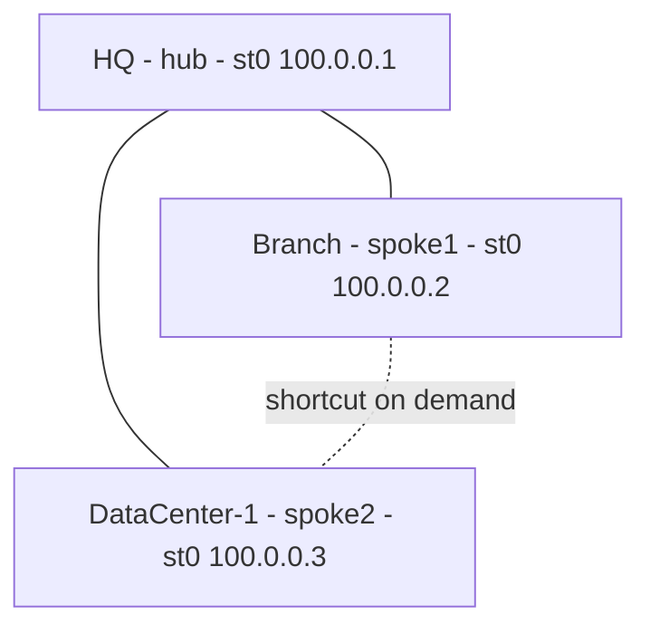

# ADVPN Lab on Juniper SRX

From routing instances to OSPF: problems, fixes and experiments, with the real outputs.


Lab: three SRX devices (HQ, Branch, DataCenter-1) · November 2026



## 1. Goal and topology


The goal is to build ADVPN: a permanent tunnel between the hub and every spoke. When traffic goes from one spoke to another through the hub, the hub suggests to both of them to build a direct tunnel (a shortcut), and the shortcut is removed again when it becomes idle.

| Device | Role | st0.0 address | External address | Instance | LAN networks |
|---|---|---|---|---|---|
| HQ | hub (suggester) | 100.0.0.1/29 | 10.10.30.1 | ADVPN-HQ-INSTANCE | 192.168.10.0/29, 20, 30 |
| Branch | spoke1 | 100.0.0.2/29 | 10.10.40.1 | ADVPN-Branch-INSTANCE | 192.168.50.0/29, 60 |
| DataCenter-1 | spoke2 | 100.0.0.3/29 | 10.10.50.2 | ADVPN-DATACenter-INSTANCE | 192.168.80.0/29, 90 |

Every device works as a gateway and already runs eBGP with the ISP network in the main routing table (the master). The device-level ASN is 100 on HQ, 200 on Branch and 300 on DC (taken from the AS paths in the outputs). The tunnels use IKEv2 with certificate (RSA) authentication.

## 2. Initial design and why a routing instance

An SRX allows only one ASN at device level, and that ASN is already used for eBGP with the ISP. So a routing instance of type virtual-router with its own ASN (65000) was created. It holds the interface st0.0 and runs iBGP between the hub and the spokes. The hub is a route reflector (the cluster setting) because the spokes do not peer with each other.

Because the LANs live in the master, two mechanisms connect the master and the instance:

- Master to instance (for advertising): instance-import with a policy called import-main that accepts the site prefixes exactly.
- Master toward the instance (for forwarding): static routes with next-table that point the remote site prefixes to the instance table.

The instance on HQ as it was at the beginning:

```
routing-instances ADVPN-HQ-INSTANCE {
    instance-type virtual-router;
    routing-options {
        autonomous-system 65000;
        static {
            route 192.168.50.0/29 next-hop st0.0;   # removed later
            route 192.168.60.0/29 next-hop st0.0;   # removed later
            route 192.168.80.0/29 next-hop st0.0;   # removed later
            route 192.168.90.0/29 next-hop st0.0;   # removed later
        }
        instance-import import-main;
    }
    protocols {
        bgp {
            group ADVPN-SPOKES {
                type internal;
                local-address 100.0.0.1;
                cluster 1.1.1.1;
                neighbor 100.0.0.2;
                neighbor 100.0.0.3;
            }
        }
    }
    interface st0.0;
}
```

The policy and the static routes in the master on HQ:

```
policy-statement import-main {
    term allow {
        from {
            instance master;
            route-filter 192.168.10.0/29 exact;
            route-filter 192.168.20.0/29 exact;
            route-filter 192.168.30.0/29 exact;
            route-filter 10.10.40.0/30 exact;      # not needed, removed later
        }
        then accept;
    }
    term deny-else { then reject; }
}

routing-options static {
    route 192.168.10.0/29 next-hop 10.10.10.2;
    route 192.168.20.0/29 next-hop 10.10.10.2;
    route 192.168.30.0/29 next-hop 10.10.10.2;
    route 192.168.50.0/29 next-table ADVPN-HQ-INSTANCE.inet.0;
    route 192.168.60.0/29 next-table ADVPN-HQ-INSTANCE.inet.0;
    route 192.168.80.0/29 next-table ADVPN-HQ-INSTANCE.inet.0;
    route 192.168.90.0/29 next-table ADVPN-HQ-INSTANCE.inet.0;
}
```

The first IKE and IPsec settings (hub and spoke):

```
# HQ (hub)
security ike gateway HUB-GW {
    ike-policy IKE-POL;
    dynamic { distinguished-name; connections-limit 50; ike-user-type group-ike-id; }
    external-interface ge-0/0/1.0;
    advpn { suggester; partner { disable; } }
    version v2-only;
}

# Branch (spoke)
security ike gateway SPOKE-GW {
    ike-policy IKE-POL;
    address 10.10.30.1;
    external-interface ge-0/0/1.0;
    advpn { suggester { disable; } partner { idle-time 300; idle-threshold 5; } }
    version v2-only;
}
```

The remaining parameters on both devices: the IKE proposal uses rsa-signatures, DH group14, sha-256 and aes-256-cbc. IPsec uses esp, hmac-sha-256-128 and aes-256-cbc with PFS group14. The VPN on the hub is HUB-VPN (establish-tunnels on-traffic), and on the spoke it is SPOKE-VPN (establish-tunnels immediately). The interface st0.0 is configured as multipoint.

### Notes from the first review of the configuration

Before any test, these points were found:

1. Static routes inside the instance with next-hop st0.0: on the hub the interface is multipoint so they do not work, and they would have beaten the iBGP routes because static has a lower preference value.
2. There is no export policy on the BGP group, and iBGP does not advertise local routes without one.
3. The gateway on the hub has an empty distinguished-name without a wildcard or container.
4. The route 0.0.0.0/0 with next-hop 10.10.30.1 on Branch does not work (the address is not directly connected).
5. Importing 10.10.40.0/30 on HQ and 10.10.30.0/30 on Branch into the instance is not needed (and, as seen later, it leaked into BGP).

## 3. Problem 1: the IKE tunnel does not come up

On Branch the SA state is DOWN and the responder cookie is all zeros:

```
root@Branch# run show security ike security-associations
Index   State  Initiator cookie  Responder cookie  Mode           Remote Address
6496104 DOWN   545edfa7e0c25ec0  0000000000000000  IKEv2          10.10.30.1
```

A zero responder cookie means HQ did not answer the first message (IKE_SA_INIT), so the problem is before certificates and identities. The Branch log shows the same message being resent every 10 seconds:

```
IKEv2 packet S(10.10.40.1:500 -> 10.10.30.1:500): mID=0 (retransmit count=2)
```

### Step 1: does the message reach HQ?

On HQ a capture was started on the external interface:

```
root@HQ> monitor traffic interface ge-0/0/1 no-resolve matching "udp port 500" extensive
...
10.10.40.1.500 > 10.10.30.1.500: isakmp 2.0 msgid 00000000 cookie 433b7faab78967a3->0000000000000000: phase 1 I
```

Three messages arrived, 10 seconds apart. So routing and the zone are fine and the message reached the Routing Engine. (On SRX a message rejected by host-inbound-traffic would not show up in this capture.) The cause is inside the IKE process on HQ.

### Step 2: the IKE log on HQ

IKE traceoptions were enabled on HQ:

```
set security ike traceoptions file ikelog
set security ike traceoptions flag all
```

The decisive output:

```
Found gateway matching local addr HUB-GW for remote dynamic peer, sa_cfg[HUB-VPN]
ikev2_select_sa_reply: SA selected successfully
IKED-PKID-IPC Failed to delete cert chain patricia node hub-cert
iked_pm_ike_get_certificates_callback: CA certificate find failed
ikev2_reply_cb_get_cas: Error: Get CAs failed: 65539
Negotiation failed because of error Crypto operation failed (65539)
```

Conclusion: the gateway matched and the proposals are identical, but HQ has neither a CA nor the certificate hub-cert that the IKE policy points to, so it drops the negotiation without a reply. The root cause is that the certificates had not been created yet.

A note about the diagnosis: at first the assumption was a zone problem (ike missing from host-inbound-traffic). The capture ruled that out, and the IKE log gave the real answer.

## 4. Creating the CA and the certificates on the devices themselves

There is no external server, so HQ was made the CA using the openssl that exists on Junos, and the certificates of the three devices were signed from it.

### 4.1 Checking the tools and the time

```
root@HQ> start shell
root@HQ:~ # which openssl
/usr/bin/openssl
root@HQ> show system uptime
Current time: 2026-11-18 20:55:27 UTC
```

Certificates are checked against their dates, so the time must be close between the devices.

### 4.2 Creating the CA on HQ

The first attempt failed because openssl on Junos is a trimmed version:

```
# openssl genrsa -out ca.key 2048
Invalid command 'genrsa'; type "help" for a list.
```

The fix: the req command with -newkey creates the key by itself, and a small config file makes the certificate a real CA (CA:TRUE). The commands run inside an sh shell:

```
cd /var/tmp/lab-ca
cat > ca.cnf << 'EOF'
[req]
distinguished_name = dn
prompt = no
x509_extensions = v3_ca
[dn]
CN = LAB-CA
O = lab
C = JO
[v3_ca]
basicConstraints = critical,CA:TRUE
keyUsage = critical,keyCertSign,cRLSign
EOF

openssl req -x509 -newkey rsa:2048 -nodes -keyout ca.key -out ca.crt -sha256 -days 1825 -config ca.cnf
openssl x509 -in ca.crt -noout -subject -dates
```

The result:

```
subject=CN = LAB-CA, O = lab, C = JO
notBefore=Nov 19 20:52:13 2026 GMT
notAfter=Nov 18 20:52:13 2031 GMT
# ls: ca.cnf  ca.crt  ca.key
```

Notes about pasting: the EOF line must start at the beginning of the line without spaces, and the whole block can be pasted at once. The file ca.key is the private key of the CA and stays on HQ only.

### 4.3 The hub certificate on HQ

```
request security pki generate-key-pair certificate-id hub-cert size 2048 type rsa
request security pki generate-certificate-request certificate-id hub-cert domain-name hub.lab.local subject "CN=hub,OU=lab,O=lab,C=JO" filename hub-req
```

The request is saved in /var/tmp and then signed:

```
cd /var/tmp/lab-ca
openssl x509 -req -in /var/tmp/hub-req -CA ca.crt -CAkey ca.key -CAcreateserial -sha256 -days 825 -out /var/tmp/hub.crt
```

Then the CA profile (with a commit before loading) and loading both certificates:

```
set security pki ca-profile LAB-CA ca-identity LAB-CA
set security pki ca-profile LAB-CA revocation-check disable
commit

request security pki ca-certificate load ca-profile LAB-CA filename /var/tmp/lab-ca/ca.crt
request security pki local-certificate load certificate-id hub-cert filename /var/tmp/hub.crt
```

Revocation checking is disabled because the lab has no CRL.

When the attempt was repeated, errors appeared because of leftovers of an earlier attempt. They were solved by clearing the request first and then the key pair, in that order:

```
error: Command aborted as key pair already exists. Retry after clearing the existing key pair
error: Certificate Request exists for key pair hub-cert

clear security pki certificate-request certificate-id hub-cert
clear security pki key-pair certificate-id hub-cert
```

Verification on HQ:

```
root@HQ> show security pki ca-certificate
  CA profile: LAB-CA
Certificate identifier: LAB-CA
  Issued to: LAB-CA, Issued by: CN = LAB-CA, O = lab, C = JO
  Validity: Not before: 11-19-2026 20:52 UTC  Not after: 11-18-2031 20:52 UTC

root@HQ> show security pki local-certificate
Certificate identifier: hub-cert
  Issued to: hub, Issued by: CN = LAB-CA, O = lab, C = JO
```

(The profile named ISRG_Root_X1 exists by default on the device and has nothing to do with the lab.)

### 4.4 The Branch certificate and moving files between the devices

On Branch only the key pair and the request are created, and the signing happens on HQ. Without SSH, copy and paste from the console was used.

On Branch:

```
request security pki generate-key-pair certificate-id spoke1-cert size 2048 type rsa
request security pki generate-certificate-request certificate-id spoke1-cert domain-name spoke1.lab.local subject "CN=spoke1,OU=lab,O=lab,C=JO" filename spoke1-req
set security pki ca-profile LAB-CA ca-identity LAB-CA
set security pki ca-profile LAB-CA revocation-check disable
commit

file show /var/tmp/spoke1-req
```

The text from BEGIN to END is copied, and on HQ:

```
cat > /var/tmp/spoke1-req << 'EOF'
(paste the request here)
EOF
cd /var/tmp/lab-ca
openssl x509 -req -in /var/tmp/spoke1-req -CA ca.crt -CAkey ca.key -CAcreateserial -sha256 -days 825 -out /var/tmp/spoke1.crt
```

Then ca.crt and spoke1.crt are displayed on HQ with file show and pasted on Branch with the same cat and EOF method. After that:

```
request security pki ca-certificate load ca-profile LAB-CA filename /var/tmp/ca.crt
request security pki local-certificate load certificate-id spoke1-cert filename /var/tmp/spoke1.crt
request security pki local-certificate verify certificate-id spoke1-cert
```

An error happened on the way: loading ca.crt failed because the file did not exist on Branch yet (only hub-req was in the listing):

```
error: Failed to read the certificate file /var/tmp/ca.crt. The certificate might not exist or it might be corrupted
```

After the correct paste, loading the CA asks to confirm the fingerprint (answer yes). A leftover file hub-req had also appeared on Branch from an earlier mistake. It is not needed there, because the Branch certificate is called spoke1-cert.

### 4.5 The DataCenter-1 certificate

The same steps with a different certificate-id and subject:

```
request security pki generate-key-pair certificate-id spoke2-cert size 2048 type rsa
request security pki generate-certificate-request certificate-id spoke2-cert domain-name spoke2.lab.local subject "CN=spoke2,OU=lab,O=lab,C=JO" filename spoke2-req
```

After signing on HQ, moving and pasting:

```
root@DataCenter-1> request security pki ca-certificate load ca-profile LAB-CA filename /var/tmp/ca.crt
Do you want to load this CA certificate ? [yes,no] (no) yes
CA certificate for profile LAB-CA loaded successfully

root@DataCenter-1> request security pki local-certificate load certificate-id spoke2-cert filename /var/tmp/spoke2.crt
Local certificate loaded successfully

root@DataCenter-1> request security pki local-certificate verify certificate-id spoke2-cert
local certificate spoke2-cert verification success
```

To make sure ca.crt was transferred intact, the CA fingerprint was compared on HQ and DC:

```
show security pki ca-certificate ca-profile LAB-CA detail | match sha1
    8d:4f:10:21:54:70:d4:68:29:f5:c0:86:4e:a8:85:bb:ca:e5:76:2a (sha1)    # same on HQ and DC
```

And on all devices the CA was linked to the IKE policy:

```
set security ike policy IKE-POL certificate trusted-ca ca-profile LAB-CA
```

## 5. Problem 2: AUTHENTICATION_FAILED and id NOT matched

After the certificates were installed the IKE reached the IKE_AUTH stage and then HQ rejected the request. On Branch:

```
Receiving packet: HDR, N(AUTHENTICATION_FAILED)
Error: IKE_AUTH packet is missing IDr or AUTH payload
Negotiation failed because of error Authentication failed (24)
```

On HQ the real reason shows (the Branch log alone does not show it):

```
ikev2_state_auth_responder_in_verify_signature
iked_pm_id_validate id NOT matched.
ikev2_reply_cb_public_key: Error: public_key failed: 24
```

So the certificate was read, but the identity of the spoke did not match the pattern configured on the hub.

### The actual subject of the certificate

```
root@Branch> show security pki local-certificate detail
  Subject string:
    CN=spoke1, OU=lab, O=lab, C=JO

# openssl x509 -in /var/tmp/spoke1.crt -noout -subject
subject=CN = spoke1, OU = lab, O = lab, C = JO
# openssl x509 -in /var/tmp/spoke1.crt -noout -subject -nameopt RFC2253
subject=C=JO,O=lab,OU=lab,CN=spoke1
```

### The attempts and what happened with each

| Attempt on HQ | Result |
|---|---|
| wildcard O=lab | id NOT matched |
| wildcard CN=*,OU=lab,O=lab,C=JO | id NOT matched, although the field order matches the subject |
| general-ikeid | the command does not exist (a wrong suggestion on my side, it belongs to IKEv1) |
| local-identity distinguished-name on Branch and HQ, with remote-identity distinguished-name on Branch | authentication succeeded |

The most likely explanation: an SRX sends its IP address as the identity by default when local-identity is not set, so Branch sent 10.10.40.1 while the hub expected a DN. The settings that solved the problem:

```
# Branch (and later DC)
set security ike gateway SPOKE-GW local-identity distinguished-name
set security ike gateway SPOKE-GW remote-identity distinguished-name

# HQ
set security ike gateway HUB-GW local-identity distinguished-name
```

After that the HQ log shows success messages and the NHTB build (the binding of the spoke address to the tunnel):

```
Received NHTB private IP address 100.0.0.2
iked_nhtb_install_in_kernel: NHTB install to kernel called for entry 100.0.0.2:st0.0
iked_pm_ipsec_sa_install: NHTB add passed for sa-cfg instance-HUB-VPN_67108865
```

An honest note: the full wildcard (CN=*,OU=lab,O=lab,C=JO) was not tested again after local-identity was added, so it is unknown whether it would have worked on its own. What is known is that adding local-identity is the change that coincided with success.

### When DataCenter-1 was added: container versus wildcard

At one stage a container was used instead of a wildcard:

```
container CN=spoke1,OU=lab,O=lab,C=JO   ->  Branch works
container CN=spoke2,OU=lab,O=lab,C=JO   ->  DC works, Branch breaks
```

A container matches exactly one DN, so it is not suitable for more than one spoke. The final solution is a shorter wildcard that covers every certificate with the same OU, O and C:

```
set security ike gateway HUB-GW dynamic distinguished-name wildcard OU=lab,O=lab,C=JO
```

The result on HQ:

```
root@HQ# run show security ike security-associations
Index   State  Initiator cookie  Responder cookie  Mode           Remote Address
5768090 UP     3104f460419750d7  8942a3ed9247c6d5  IKEv2          10.10.50.2
5768091 UP     1e6bc57b214fea02  0cf3fa9bae69ee5f  IKEv2          10.10.40.1

root@HQ> show security ipsec next-hop-tunnels
Next-hop gateway  interface   IPSec VPN name  Flag   IKE-ID
100.0.0.2         st0.0       HUB-VPN         Auto   CN=spoke1, OU=lab, O=lab, C=JO
100.0.0.3         st0.0       HUB-VPN         Auto   CN=spoke2, OU=lab, O=lab, C=JO
```

## 6. Bringing BGP up inside the instances

### 6.1 Sessions stuck in Connect

Once the IKE and IPsec tunnels were up, the iBGP sessions still stayed in Connect. The tunnel itself worked, because the instance could ping the hub's st0 address:

```
root@Branch> ping 100.0.0.1 routing-instance ADVPN-Branch-INSTANCE count 3
64 bytes from 100.0.0.1: icmp_seq=0 ttl=64 time=16.332 ms
64 bytes from 100.0.0.1: icmp_seq=1 ttl=64 time=4.615 ms
64 bytes from 100.0.0.1: icmp_seq=2 ttl=64 time=4.707 ms
3 packets transmitted, 3 packets received, 0% packet loss

root@Branch> show bgp summary instance ADVPN-Branch-INSTANCE
Peer         AS     InPkt  OutPkt  State
100.0.0.1    65000  0      0       Connect
```

Cause: the security zone that holds st0.0 (zone ADVPN) allowed only ping and ike in host-inbound-traffic, so BGP (TCP 179) was dropped. Fix, on all devices:

```
set security zones security-zone ADVPN interfaces st0.0 host-inbound-traffic protocols bgp
```

After the commit:

```
Peer         AS     InPkt  OutPkt  State
100.0.0.1    65000  4      3       Establ
  ADVPN-Branch-INSTANCE.inet.0: 1/1/1/0
```

Small gotcha: each device has its own instance name. Running show bgp summary instance ADVPN-HQ-INSTANCE on Branch returns Groups: 0 Peers: 0, which looks like a broken BGP but is only a wrong name.

### 6.2 The only routes exchanged were ISP routes

Each side received exactly one route, and it was not a LAN route:

```
root@Branch> show route receive-protocol bgp 100.0.0.1 table ADVPN-Branch-INSTANCE.inet.0
* 10.10.40.0/30   10.10.30.2   100   100 1000 4000 2000 I

root@HQ> show route receive-protocol bgp 100.0.0.2 table ADVPN-HQ-INSTANCE.inet.0
* 10.10.30.0/30   10.10.40.2   100   200 2000 4000 1000 I
```

These are the eBGP routes toward the ISP. The instance-import policy pulled them into the instance as BGP routes, and iBGP re-advertises BGP-learned routes by default even without an export policy. Fixes applied on both devices:

- removed the two unneeded route-filters (10.10.40.0/30 on HQ, 10.10.30.0/30 on Branch) from import-main
- deleted the static routes with next-hop st0.0 from inside the instances
- added an export policy so that the LAN prefixes are really advertised

```
# HQ
delete policy-options policy-statement import-main term allow from route-filter 10.10.40.0/30 exact
delete routing-instances ADVPN-HQ-INSTANCE routing-options static
set policy-options policy-statement ADVPN-EXPORT term lans from protocol static
set policy-options policy-statement ADVPN-EXPORT term lans from route-filter 192.168.10.0/29 exact
set policy-options policy-statement ADVPN-EXPORT term lans from route-filter 192.168.20.0/29 exact
set policy-options policy-statement ADVPN-EXPORT term lans from route-filter 192.168.30.0/29 exact
set policy-options policy-statement ADVPN-EXPORT term lans then accept
set policy-options policy-statement ADVPN-EXPORT term else then reject
set routing-instances ADVPN-HQ-INSTANCE protocols bgp group ADVPN-SPOKES export ADVPN-EXPORT

# Branch (LANs reach the instance from the master OSPF, hence protocol ospf)
delete policy-options policy-statement import-main term allow from route-filter 10.10.30.0/30 exact
delete routing-instances ADVPN-Branch-INSTANCE routing-options static
set policy-options policy-statement ADVPN-EXPORT term lans from protocol ospf
set policy-options policy-statement ADVPN-EXPORT term lans from route-filter 192.168.50.0/29 exact
set policy-options policy-statement ADVPN-EXPORT term lans from route-filter 192.168.60.0/29 exact
set policy-options policy-statement ADVPN-EXPORT term lans then accept
set policy-options policy-statement ADVPN-EXPORT term else then reject
set routing-instances ADVPN-Branch-INSTANCE protocols bgp group ADVPN-SPOKES export ADVPN-EXPORT
```

### 6.3 Routes arrived but were hidden

After the export policy the LAN routes arrived, but every one of them was hidden (3 on Branch, 2 on HQ, matching the number of remote LAN prefixes):

```
root@Branch> show route hidden table ADVPN-Branch-INSTANCE.inet.0 extensive
192.168.10.0/29 (1 entry, 0 announced)
         BGP    Preference: 170/-101
                Next hop type: Unusable
                State: <Hidden Int Ext Changed>
                Source: 100.0.0.1
                Protocol next hop: 10.10.10.2 ResolvState: PnhUnresolv
```

On HQ the unresolved protocol next hop was 10.10.20.2. The routes carried the LAN-side next hop of the originating device (10.10.10.2 behind HQ, 10.10.20.2 behind Branch), which the receiver cannot resolve inside the instance. Fix, on both devices:

```
set policy-options policy-statement ADVPN-EXPORT term lans then next-hop self
```

### 6.4 First end-to-end success

A host behind Branch could now reach a host behind HQ, and the trace shows the path through the tunnel:

```
VPC27> trace 192.168.30.2
 1   192.168.60.5
 2   Redirect Network, gateway 192.168.60.1 -> 192.168.60.6
 1   192.168.60.6
 2   10.10.20.1      Branch
 3   100.0.0.1       HQ st0.0, through the tunnel
 4   10.10.10.2
 5   *192.168.30.2   ICMP type 3 code 3 is just the end of a UDP trace
```

The ICMP redirect comes from the local LAN router and is unrelated to the VPN.

## 7. Adding DataCenter-1 and the spoke-to-spoke problems

### 7.1 Onboarding the second spoke

DataCenter-1 got its certificate (section 4.5), the same IKE and IPsec configuration as Branch with local-identity and remote-identity distinguished-name, st0.0 as multipoint with 100.0.0.3/29, the zone ADVPN with ike, ping and bgp on st0.0, and an instance ADVPN-DATACenter-INSTANCE with AS 65000 and neighbor 100.0.0.1.

```
root@DataCenter-1# show security ike gateway SPOKE-GW
ike-policy IKE-POL;
address 10.10.30.1;
local-identity distinguished-name;
remote-identity distinguished-name;
external-interface ge-0/0/1;
advpn {
    suggester { disable; }
    partner { idle-time 300; idle-threshold 5; }
}
version v2-only;
```

The BGP session came up, but HQ showed 0/0/0/0 for it, meaning DC advertised nothing. This was fixed on the DC side (import and export policies inside the instance), after which HQ showed 2/2/2/0 for both spokes and Branch learned 192.168.80.0/29 and 192.168.90.0/29.

### 7.2 Network unreachable generated by the spokes themselves

```
Branch-PC1> ping 192.168.80.2
*10.10.20.1 icmp_seq=1 ... (ICMP type:3, code:0, Destination network unreachable)

DC-PC1> ping 192.168.50.2
*10.10.60.1 icmp_seq=1 ... (ICMP type:3, code:0, Destination network unreachable)
```

The replies come from the spokes' own gateway addresses (10.10.20.1 on Branch, 10.10.60.1 on DC), so the packets die in the spoke's own forwarding. The RIB looked healthy:

```
192.168.80.0/29  *[BGP/170] localpref 100, from 100.0.0.1
                    AS path: 300 I
                 >  to 100.0.0.3 via st0.0
```

but the forwarding table had no entry for the prefix:

```
root@Branch# run show route forwarding-table destination 192.168.80.2
Routing table: default.inet
192.168.80.0/29    user     0                    rtbl      536     7
Routing table: ADVPN-Branch-INSTANCE.inet
default            perm     0                    rjct      530     1
```

The master pointed into the instance (rtbl), and the instance only had its default reject. The reflected route kept the next hop 100.0.0.3, but before a shortcut exists Branch has no tunnel binding (NHTB entry) toward 100.0.0.3, so the next hop could not be installed for forwarding. Fix: the hub reflects spoke routes with itself as next hop, so the first packets go to the hub.

```
# HQ: term reflect, placed before term else
set policy-options policy-statement ADVPN-EXPORT term reflect from protocol bgp
set policy-options policy-statement ADVPN-EXPORT term reflect then next-hop self
set policy-options policy-statement ADVPN-EXPORT term reflect then accept
insert policy-options policy-statement ADVPN-EXPORT term reflect before term else
```

### 7.3 Timeouts and the missing hub policy

After that the unreachable replies turned into timeouts. DC was sending the packets into st0.0 and HQ had no session at all:

```
root@DataCenter-1# run show security flow session destination-prefix 192.168.50.3
Session ID: 398, Policy name: internal-VPN/8, Timeout: 32, Session State: Valid
  In: 192.168.80.2/59957 --> 192.168.50.3/1;icmp, If: ge-0/0/0.0, Pkts: 1, Bytes: 84,
  Out: 192.168.50.3/1 --> 192.168.80.2/59957;icmp, If: st0.0, Pkts: 0, Bytes: 0,

root@HQ# run show security flow session destination-prefix 192.168.50.3
Total sessions: 0
```

Cause: spoke-to-spoke traffic through the hub enters and leaves HQ on st0.0, so both directions are in zone ADVPN, and SRX denies intra-zone traffic by default. A packet denied by policy never creates a session, which is why HQ showed zero. Fix on HQ:

```
set security policies from-zone ADVPN to-zone ADVPN policy ADVPN-ADVPN match source-address any
set security policies from-zone ADVPN to-zone ADVPN policy ADVPN-ADVPN match destination-address any
set security policies from-zone ADVPN to-zone ADVPN policy ADVPN-ADVPN match application any
set security policies from-zone ADVPN to-zone ADVPN policy ADVPN-ADVPN then permit
```

After that DC-PC1 could ping Branch hosts:

```
DC-PC1> ping 192.168.50.3 -t 1000
84 bytes from 192.168.50.3 icmp_seq=1 ttl=59 time=10.697 ms
84 bytes from 192.168.50.3 icmp_seq=2 ttl=59 time=8.228 ms
```

### 7.4 Why the first packets must go through the hub

An obvious question was whether traffic between the spokes should avoid the hub entirely, for example with a null next hop. It should not: the hub is what triggers ADVPN. It forwards the first spoke-to-spoke packets, notices them, and sends both spokes a shortcut suggestion. A null route drops the packet at the spoke, the hub never sees traffic, and no shortcut is ever created. The goal is only that later packets stop using the hub.

### 7.5 The shortcut formed, but traffic still used the hub

After the ping Branch had a second IKE SA toward DC and a second IPsec SA:

```
root@Branch# run show security ike security-associations
6497651 UP  ...  10.10.30.1
6497653 UP  ...  10.10.50.2
root@Branch# run show security ipsec security-associations
  <67108870 ESP:aes-cbc-256/sha256 ...  10.10.50.2
```

but the trace from DC still went through the hub:

```
DC-PC1> trace 192.168.50.3
 3   100.0.0.1
 4   100.0.0.2
 5   10.10.20.2
```

and DC's tables showed the reason:

```
root@DataCenter-1> show security ipsec next-hop-tunnels
100.0.0.1   st0.0   ...  CN=hub, OU=lab, O=lab, C=JO
100.0.0.2   st0.0   ...  CN=spoke1, OU=lab, O=lab, C=JO

root@DataCenter-1> show route forwarding-table destination 192.168.50.3
Routing table: ADVPN-DATACenter-INSTANCE.inet
192.168.50.0/29    user     0    indr   262143     6
                              100.0.0.1          ucst      584     4 st0.0
```

The binding to the other spoke (100.0.0.2) existed, but the route still pointed at the hub. With next-hop self on the hub every spoke prefix points at 100.0.0.1, and iBGP does not update the route when a shortcut appears.

## 8. BGP-only experiment: direct iBGP sessions between the spokes

### 8.1 The idea

The requirement at this point was to stay with BGP and not use OSPF. When a shortcut exists, the two spokes can reach each other's st0 address, so they can peer directly, and the routes learned directly can be preferred with a higher local-preference. The existing sessions with the hub stay as they are, and nothing changes on HQ. This was my own idea, it is not a design documented by Juniper.

On Branch (DC mirrors it with local-address 100.0.0.3, neighbor 100.0.0.2 and the instance ADVPN-DATACenter-INSTANCE):

```
set policy-options policy-statement PREFER-DIRECT term all then local-preference 200
set policy-options policy-statement PREFER-DIRECT term all then accept
set routing-instances ADVPN-Branch-INSTANCE protocols bgp group SPOKES-DIRECT type internal
set routing-instances ADVPN-Branch-INSTANCE protocols bgp group SPOKES-DIRECT local-address 100.0.0.2
set routing-instances ADVPN-Branch-INSTANCE protocols bgp group SPOKES-DIRECT neighbor 100.0.0.3
set routing-instances ADVPN-Branch-INSTANCE protocols bgp group SPOKES-DIRECT import PREFER-DIRECT
set routing-instances ADVPN-Branch-INSTANCE protocols bgp group SPOKES-DIRECT export ADVPN-EXPORT
```

Result on DC: both sessions established, and the direct route won:

```
root@DataCenter-1> show bgp summary instance ADVPN-DATACenter-INSTANCE
Peer         AS     InPkt  OutPkt  State
100.0.0.1    65000  2681   2685    Establ   3/5/5/0
100.0.0.2    65000  4      3       Establ   2/2/2/0

192.168.50.0/29  *[BGP/170] 00:00:21, MED 2, localpref 200
                    AS path: 200 I
                 >  to 100.0.0.2 via st0.0
                  [BGP/170] 19:45:01, MED 2, localpref 100
                    AS path: 200 I
                 >  to 100.0.0.1 via st0.0

root@DataCenter-1> show route forwarding-table destination 192.168.50.3
Routing table: ADVPN-DATACenter-INSTANCE.inet
192.168.50.0/29    user     0    indr   262144     3
                              100.0.0.2          ucst      590     4 st0.0

DC-PC1> trace 192.168.50.3
 1   192.168.80.1
 2   10.10.60.1
 3   100.0.0.2
 4   10.10.20.2
 5   *192.168.50.3
```

The hub (100.0.0.1) is gone from the path. In the opposite direction (Branch toward DC) the first trace still went 100.0.0.1 then 100.0.0.3, because the direct session had not come up yet. After it did, the trace went through 100.0.0.3 only.

### 8.2 Failure tests

Method: a continuous ping from a DC host to a Branch host, while clearing security associations on DC.

**Test 1, default hold time (90 s):**

```
root@DataCenter-1> clear security ike security-associations 10.10.40.1
root@DataCenter-1> clear security ipsec security-associations
```

Result: about 39 s of timeouts (icmp_seq 16 to 54), then about 59 s of Destination network unreachable from the DC gateway (icmp_seq 55 to 113), then traffic came back through the hub (ttl 58), and after 6 packets went direct again (ttl 59). Total outage about 98 s, which matches the BGP hold timer. The direct session kept advertising a dead route until the timer expired.

**Test 2, hold-time 9 on the SPOKES-DIRECT group on both spokes:**

```
set routing-instances ADVPN-DATACenter-INSTANCE protocols bgp group SPOKES-DIRECT hold-time 9
set routing-instances ADVPN-Branch-INSTANCE protocols bgp group SPOKES-DIRECT hold-time 9
```

Result: timeouts from icmp_seq 5 to 27 (about 23 s), traffic back through the hub at icmp_seq 28 (ttl 58), direct again at icmp_seq 31 (ttl 59).

**Test 3, BFD with a 500 ms interval and multiplier 3:**

```
set routing-instances ADVPN-DATACenter-INSTANCE protocols bgp group SPOKES-DIRECT bfd-liveness-detection minimum-interval 500
set routing-instances ADVPN-DATACenter-INSTANCE protocols bgp group SPOKES-DIRECT bfd-liveness-detection multiplier 3
set security zones security-zone ADVPN interfaces st0.0 host-inbound-traffic protocols bfd

root@Branch# run show bfd session
Address      State  Interface  Detect Time  Transmit Interval  Multiplier
100.0.0.3    Up     st0.0      1.500        0.500              3
```

The outage in that run was about 29 s, but the three tests are not comparable. The command clear security ipsec security-associations without an index clears every tunnel, including the hub tunnel, so these numbers include rebuilding the hub tunnel and its BGP session. The correct test clears only the shortcut SA by index (done later with OSPF). Two commands were also wrong along the way: show bfd session instance is not valid, plain show bfd session is.

### 8.3 Why BGP with BFD was dropped

The decisive observation came from the lab itself: BFD sends two packets per second through the shortcut, so the tunnel always looks busy and the idle timer (idle-time 300, idle-threshold 5) can never remove it. The BGP keepalives of the direct session have the same effect, only slower. A shortcut that never goes away loses the on-demand property that makes ADVPN useful. Other drawbacks: every spoke needs a neighbor statement for every other spoke, the failure behavior depends on timers, and Juniper's own ADVPN example does not use this design. Decision: keep the BGP configuration but deactivate it, and move to OSPF.

## 9. Moving to OSPF

### 9.1 Why OSPF fits ADVPN

Juniper's ADVPN example runs OSPF in point-to-multipoint mode on st0. At the start each spoke has an adjacency only with the hub, so routes toward other spokes point at the hub and the first packets go through it. When a shortcut forms, the two spokes build an adjacency across it. The hub interface metric is 10 and the spoke interface metric is 15, so the direct path costs 15 while the path through the hub costs 25, and the routes switch to the shortcut by themselves. No extra neighbor statements are needed.

Two interface options explained:

- interface-type p2mp: OSPF treats st0.0 as a set of separate point-to-point links. There is no DR election, and each neighbor has its own relationship. This is the right model for a multipoint tunnel interface.
- demand-circuit (RFC 1793): after the adjacency is synchronized, OSPF stops periodic hellos and periodic LSA refreshes, and sends something only when the topology changes. This is what lets an idle shortcut stay silent so that the idle timer can remove it. That purpose is my reading of the option, the Juniper example uses it without explaining why.

### 9.2 Steps

**Step 1: deactivate BGP and keep its configuration** (activate brings it back; the BFD settings live inside the BGP group and are deactivated with it):

```
deactivate routing-instances ADVPN-HQ-INSTANCE protocols bgp
deactivate routing-instances ADVPN-Branch-INSTANCE protocols bgp
deactivate routing-instances ADVPN-DATACenter-INSTANCE protocols bgp
```

(each command on its own device). The sites lose connectivity until OSPF converges.

**Step 2: allow OSPF in the tunnel zone, on all three devices:**

```
set security zones security-zone ADVPN interfaces st0.0 host-inbound-traffic protocols ospf
```

**Step 3: OSPF configuration.** The LANs live in the master and enter the instance through instance-import, so each device needs an export policy that advertises its own LAN prefixes into OSPF.

HQ (hub, metric 10):

```
set policy-options policy-statement ADVPN-OSPF-EXPORT term lans from route-filter 192.168.10.0/29 exact
set policy-options policy-statement ADVPN-OSPF-EXPORT term lans from route-filter 192.168.20.0/29 exact
set policy-options policy-statement ADVPN-OSPF-EXPORT term lans from route-filter 192.168.30.0/29 exact
set policy-options policy-statement ADVPN-OSPF-EXPORT term lans then accept
set policy-options policy-statement ADVPN-OSPF-EXPORT term else then reject
set routing-instances ADVPN-HQ-INSTANCE protocols ospf area 0.0.0.0 interface st0.0 interface-type p2mp
set routing-instances ADVPN-HQ-INSTANCE protocols ospf area 0.0.0.0 interface st0.0 metric 10
set routing-instances ADVPN-HQ-INSTANCE protocols ospf area 0.0.0.0 interface st0.0 retransmit-interval 1
set routing-instances ADVPN-HQ-INSTANCE protocols ospf area 0.0.0.0 interface st0.0 dead-interval 40
set routing-instances ADVPN-HQ-INSTANCE protocols ospf area 0.0.0.0 interface st0.0 demand-circuit
set routing-instances ADVPN-HQ-INSTANCE protocols ospf area 0.0.0.0 interface st0.0 dynamic-neighbors
set routing-instances ADVPN-HQ-INSTANCE protocols ospf export ADVPN-OSPF-EXPORT
```

Branch and DataCenter-1 use the same pattern with metric 15, their own instance names (ADVPN-Branch-INSTANCE, ADVPN-DATACenter-INSTANCE) and their own prefixes (192.168.50.0/29 and 192.168.60.0/29 on Branch, 192.168.80.0/29 and 192.168.90.0/29 on DC) in the route-filters. Example for Branch:

```
set policy-options policy-statement ADVPN-OSPF-EXPORT term lans from route-filter 192.168.50.0/29 exact
set policy-options policy-statement ADVPN-OSPF-EXPORT term lans from route-filter 192.168.60.0/29 exact
set policy-options policy-statement ADVPN-OSPF-EXPORT term lans then accept
set policy-options policy-statement ADVPN-OSPF-EXPORT term else then reject
set routing-instances ADVPN-Branch-INSTANCE protocols ospf area 0.0.0.0 interface st0.0 interface-type p2mp
set routing-instances ADVPN-Branch-INSTANCE protocols ospf area 0.0.0.0 interface st0.0 metric 15
set routing-instances ADVPN-Branch-INSTANCE protocols ospf area 0.0.0.0 interface st0.0 retransmit-interval 1
set routing-instances ADVPN-Branch-INSTANCE protocols ospf area 0.0.0.0 interface st0.0 dead-interval 40
set routing-instances ADVPN-Branch-INSTANCE protocols ospf area 0.0.0.0 interface st0.0 demand-circuit
set routing-instances ADVPN-Branch-INSTANCE protocols ospf area 0.0.0.0 interface st0.0 dynamic-neighbors
set routing-instances ADVPN-Branch-INSTANCE protocols ospf export ADVPN-OSPF-EXPORT
```

### 9.3 First verification

```
root@HQ# run show ospf neighbor instance ADVPN-HQ-INSTANCE
Address          Interface   State   ID          Pri  Dead
100.0.0.2        st0.0       Full    100.0.0.2   128  -
100.0.0.3        st0.0       Full    100.0.0.3   128  -

root@DataCenter-1# run show route table ADVPN-DATACenter-INSTANCE.inet.0
100.0.0.1/32       *[OSPF/10] 00:01:15, metric 15   > to 100.0.0.1 via st0.0
100.0.0.2/32       *[OSPF/10] 00:01:15, metric 25   > to 100.0.0.1 via st0.0
192.168.10.0/29    *[OSPF/150] 00:01:15, metric 0   > to 100.0.0.1 via st0.0
192.168.20.0/29    *[OSPF/150] 00:01:15, metric 0   > to 100.0.0.1 via st0.0
192.168.30.0/29    *[OSPF/150] 00:01:15, metric 0   > to 100.0.0.1 via st0.0
192.168.50.0/29    *[OSPF/150] 00:01:15, metric 2   > to 100.0.0.1 via st0.0
192.168.60.0/29    *[OSPF/150] 00:01:15, metric 2   > to 100.0.0.1 via st0.0
192.168.80.0/29    *[Static/5] 21:42:29             > to 10.10.60.2 via ge-0/0/0.0
```

Both neighbors reached Full, and the prefixes of every site arrived as OSPF external routes (preference 150). That also answered a doubt I had: routes that reach the instance from the master's own OSPF (Branch) can be re-advertised by a policy without any extra trick.

The first ping from a DC host to 192.168.50.3 timed out, even though the routes were correct. The cause was the end device behind Branch, not the VPN: pinging 192.168.50.2 worked.

## 10. Test results with OSPF

### 10.1 Traffic moves to the shortcut with no packet loss

```
DC-PC2> ping 192.168.50.2 -t 1000
84 bytes from 192.168.50.2 icmp_seq=1 ttl=59 time=12.155 ms
...
84 bytes from 192.168.50.2 icmp_seq=11 ttl=59 time=7.459 ms
84 bytes from 192.168.50.2 icmp_seq=12 ttl=60 time=5.739 ms
84 bytes from 192.168.50.2 icmp_seq=13 ttl=60 time=5.715 ms
```

For the first 11 packets the ttl is 59, which is the path through the hub, then it becomes 60: the shortcut is used. Not one packet was lost during the switch. The trace and the forwarding table confirm it:

```
DC-PC2> trace 192.168.50.2
 1   192.168.90.1
 2   10.10.60.1
 3   100.0.0.2
 4   10.10.20.2
 5   *192.168.50.2

root@DataCenter-1# run show route forwarding-table destination 192.168.50.2
Routing table: ADVPN-DATACenter-INSTANCE.inet
192.168.50.0/29    user     0 100.0.0.2          ucst      590     4 st0.0
```

The hub (100.0.0.1) no longer appears, and the next hop is Branch's st0 address through the shortcut.

### 10.2 Idle test: the shortcut disappears

After the pings stopped and the idle time (300 s) had passed, DC kept only its hub tunnel:

```
root@DataCenter-1# run show security ike security-associations
Index   State  Initiator cookie  Responder cookie  Mode   Remote Address
5788453 UP     f04ce41fbaaa0c4b  7858154f74b85ea0  IKEv2  10.10.30.1
```

The shortcut to Branch was removed. This is the on-demand behavior that BGP with keepalives and BFD could not deliver. The most likely reason is demand-circuit, but OSPF was not tested without it, so that is an assumption.

### 10.3 Shortcut failure test: only the shortcut is cleared

This time the exact shortcut SA was cleared, and the hub tunnel was left alone:

```
root@DataCenter-1# run show security ipsec security-associations
  <67108866 ESP:aes-cbc-256/sha256 ...  10.10.30.1     (hub)
  <67108898 ESP:aes-cbc-256/sha256 ...  10.10.40.1     (shortcut)

root@DataCenter-1# clear security ike security-associations 10.10.40.1
root@DataCenter-1# clear security ipsec security-associations index 67108898
```

Ping from a DC host to 192.168.50.2 during the test:

```
icmp_seq=4  to 38   ttl=60   shortcut
icmp_seq=39 to 50   ttl=59   through the hub, no timeout
icmp_seq=51 onward  ttl=60   shortcut rebuilt
```

Zero packets lost. Traffic fell back to the hub immediately, and the shortcut was rebuilt after about 12 seconds of continued traffic.

## 11. Final state and cleanup

### 11.1 What ends up on each device

| Device | Components |
|---|---|
| HQ (hub) | PKI with LAB-CA and hub-cert; IKE gateway HUB-GW with dynamic wildcard OU=lab,O=lab,C=JO, local-identity distinguished-name and advpn suggester; IPsec VPN HUB-VPN; st0.0 multipoint 100.0.0.1/29; zone ADVPN with policy ADVPN to ADVPN; instance ADVPN-HQ-INSTANCE with OSPF p2mp (metric 10); import-main and static routes with next-table in the master |
| Branch (spoke1) | PKI with LAB-CA and spoke1-cert; IKE gateway SPOKE-GW (address 10.10.30.1, local and remote identity distinguished-name, advpn partner idle-time 300 idle-threshold 5); IPsec VPN SPOKE-VPN; st0.0 multipoint 100.0.0.2/29; instance ADVPN-Branch-INSTANCE with OSPF p2mp (metric 15) |
| DataCenter-1 (spoke2) | Same as Branch with spoke2-cert, st0.0 100.0.0.3/29, instance ADVPN-DATACenter-INSTANCE |

The zone ADVPN on all devices allows ping, ike, bgp, ospf and bfd on st0.0. Only ike and ospf are still needed after the move to OSPF.

### 11.2 Cleanup before publishing

```
# all three devices: remove IKE debugging
delete security ike traceoptions
commit

# Branch only: this default route was never usable (next hop not directly connected)
delete routing-options static route 0.0.0.0/0
commit
```

Leftovers from the BGP phase: the deactivated protocols bgp blocks, the policies ADVPN-EXPORT and PREFER-DIRECT, and the bfd line in the zone. Keep them only if the comparison with BGP should stay reproducible, otherwise delete them from the published version.

### 11.3 Capturing the real configuration

```
show configuration | display set | no-more
```

Save the output per device (hq.set, branch.set, dc.set). Never publish ca.key or any private key, and do not commit the certificates either.

## 12. BGP versus OSPF: what was measured

| Aspect | iBGP (hub reflector and direct spoke sessions) | OSPF p2mp (Juniper example) |
|---|---|---|
| First packets | through the hub | through the hub |
| Moving to the shortcut | needs an extra direct session on every spoke pair; the first trace in the reverse direction still used the hub | automatic; first 11 pings through the hub, then shortcut, no packets lost |
| Shortcut failure | about 98 s with the default hold time, about 23 s with hold-time 9 (these tests also cleared the hub tunnel) | no packets lost, 12 s on the hub path, then shortcut rebuilt |
| Idle teardown | blocked by BGP keepalives and by BFD | the shortcut was removed after idling (demand-circuit is the likely reason) |
| Configuration per spoke | one neighbor for every other spoke | none |
| Documented by Juniper for ADVPN | no, my own experiment | yes |

Caution when reading the table: the BGP failure tests cleared all IPsec SAs, while the OSPF test cleared only the shortcut. The difference is real in direction, but the numbers are not a like-for-like benchmark.

## 13. Mistakes, corrections and lessons

This lab was solved with a lot of trial and error. These are the wrong turns, listed so that they are not repeated:

1. **The first diagnosis of the dead tunnel was the zone.** The packet capture showed the packets arrived, and the IKE log showed the real cause, a missing CA and certificate. Read the log of the responder before changing anything.
2. **The wildcard theory.** Several wildcard patterns were tried while the real problem was the identity type sent by the spoke. Set local-identity distinguished-name explicitly when the peer matches on DN.
3. **general-ikeid does not exist for this case.** It was suggested by mistake (it belongs to IKEv1).
4. **Container versus wildcard.** A container matches exactly one DN. It worked for one spoke and broke the other.
5. **A wrong instance name in a show command** (ADVPN-DC-INSTANCE instead of ADVPN-DATACenter-INSTANCE) and a wrong BFD command produced empty or invalid output. Check names before trusting an empty result.
6. **A route in the RIB is not proof of forwarding.** The route toward the other spoke was active in the RIB while the forwarding table only had a reject. Always check show route forwarding-table.
7. **A tunnel that exists is not a tunnel that is used.** The shortcut SA was up while traffic still used the hub, because routing had not moved. Check the trace and the forwarding next hop, not only the SA list.
8. **Measuring the shortcut failure correctly.** Clearing all SAs also clears the hub tunnel. Clear the one SA by index.
9. **The BGP-only design was an experiment.** It worked, but keepalives and BFD defeat the idle timer. The documented OSPF design behaved better in every test.
10. **Do not blame the VPN for an end device.** One failing ping (192.168.50.3) was a host behind Branch; a second address on the same LAN worked.

## Appendix: troubleshooting cheat sheet

| Symptom | Check | Typical cause |
|---|---|---|
| IKE DOWN, responder cookie all zeros | monitor traffic on the external interface, then the IKE log on the responder | missing CA or local certificate, zone without ike |
| AUTHENTICATION_FAILED | log line id NOT matched | identity type or DN pattern mismatch |
| BGP stuck in Connect | zone host-inbound-traffic on st0.0 | protocols bgp missing |
| Routes hidden, PnhUnresolv | show route hidden extensive | next hop not resolvable, use next-hop self |
| Network unreachable from the spoke gateway | show route forwarding-table destination | next hop without tunnel binding |
| Timeouts and zero sessions on the hub | show security flow session on every hop | missing policy from ADVPN to ADVPN |
| Shortcut up, traffic still through the hub | trace and forwarding table | routing did not move to the shortcut |

Useful commands:

```
show security ike security-associations
show security ipsec security-associations
show security ipsec next-hop-tunnels
show ospf neighbor instance <instance>
show route table <instance>.inet.0
show route forwarding-table destination <ip>
show security flow session destination-prefix <ip>
show log ikelog | last 80
```
